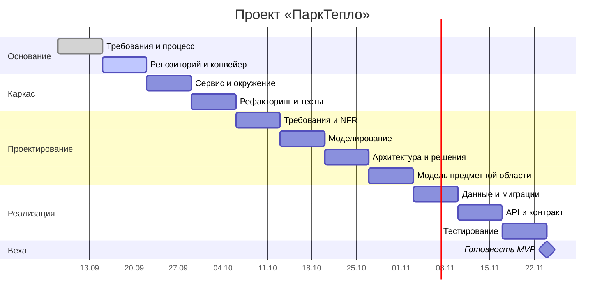

# План семестра

**Контрольные точки:**

| Точка | Срок | Критерий прохождения |
| --- | --- | --- |
| Требования утверждены | конец М01 | Домен согласован, MVP зафиксирован |
| Конвейер зелёный | конец М02 | Ветка защищена, проверки проходят |
| Сервис поднимается | конец М03 | Одна команда — работающее окружение |
| MVP работает | конец М11 | Сквозной сценарий проходится целиком |

**Буфер:** 20 % времени каждой вехи заложено на непредвиденное. Расход буфера фиксируется в журнале изменений.
