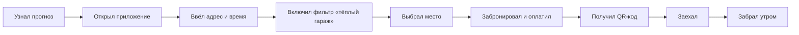

# Требования

## Предметная область

### Кандидат 1: ПаркТепло — аренда парковок и тёплых гаражей

| Требование | Проверка | Итог |
| --- | --- | --- |
| 2–3 ограниченных контекста | Места и объекты · Бронирование и доступ · Платежи и выплаты · Пользователи и отзывы · Уведомления | ✅ пять |
| Внешняя интеграция | Карты и геолокация, платёжный шлюз, СКУД/умные замки, QR-коды, прогноз погоды, email/SMS/push | ✅ |
| Пользовательский интерфейс | Карта, поиск по адресу и времени, фильтры «тёплый гараж», «розетка», карточка места, бронирование, личный кабинет, панель владельца | ✅ |
| Нетривиальные данные | Места, типы отопления, температура, розетки, интервалы, брони, автомобили, платежи, залоги, логи доступа, отзывы | ✅ связи и история |

**Вывод:** домен проходит.

## Постановка проблемы

**Что**: В мороз машины на улице не заводятся, аккумулятор садится, прогрев занимает время, а свободные тёплые гаражи и подземные паркинги простаивают. Найти тёплое место на ночь заранее почти невозможно — всё решается через знакомых и объявления.

**Для кого**: Водители, которые оставляют машину во дворе и мучаются с запуском зимой, и владельцы частных гаражей, машиномест и подземных паркингов, которые хотят сдавать их на часы или ночь.

**Зачем**: Водитель гарантированно получает тёплое место и утром не рискует опоздать; владелец зарабатывает на простое.

**Как измерим успех**: Доля броней тёплых гаражей в зимний период, загрузка тёплых мест в морозные ночи, доля повторных броней.

### Персона: Водитель из спального района

**Роль и контекст**: Каждый день ездит на работу, машина стоит во дворе. Зимой тратит 15–20 минут на прогрев и рискует не завестись.

**Цель**: Оставить машину на ночь в тёплом месте и утром уехать без сюрпризов.

**Как решает задачу сейчас**: Спрашивает знакомых, ищет объявления, иногда ставит на платную парковку без отопления.

**Боли**:

- Не знает, есть ли свободный тёплый гараж рядом
- Боится, что место займут
- Непонятно, можно ли продлить, если машина не завелась

**Что важно**: Видеть температуру и розетку; бронировать за пару минут; получать доступ без звонков.

### Персона: Владелец гаража или машиноместа

**Роль и контекст**: Имеет гараж или место в подземном паркинге, которое простаивает. Зимой хочет сдавать его на ночь или на неделю.

**Цель**: Получать доход и не заниматься поиском клиентов вручную.

**Как решает задачу сейчас**: Пишет в чаты домов, клеит объявления, договаривается по телефону.

**Боли**:

- Не хочет пускать незнакомых
- Боится, что не заплатят
- Нужно вручную следить за занятостью

**Что важно**: Видеть брони и оплату; указывать температуру и условия; иметь историю доступа.

## Путь пользователя: бронирование тёплого гаража на ночь

Персона: Водитель из спального района
Сценарий: снять тёплый гараж на ночь, чтобы утром машина завелась

1. **Узнал прогноз** — вечером понял, что ночью будет −28
2. **Открыл приложение** — с телефона
3. **Ввёл адрес и время** — сегодня 22:00 — завтра 08:00
4. **Включил фильтр** — «тёплый гараж» и «розетка»
5. **Выбрал место** — гараж с температурой +12 и видеонаблюдением
6. **Забронировал и оплатил** — один шаг, без звонков
7. **Получил QR-код** — инструкция по доступу и код замка
8. **Заехал** — закрыл машину, ушёл
9. **Забрал утром** — при необходимости продлил бронь

## Минимально жизнеспособный продукт

Входит:

- Поиск тёплых гаражей на карте по адресу и времени
- Фильтр «тёплый гараж», «розетка», «доступ 24/7»
- Карточка места с температурой и условиями
- Бронирование свободного интервала
- Оплата брони
- QR-код или код доступа
- Список броней для водителя
- Список броней и занятости для владельца
- Отмена брони
- Базовые уведомления

Критерий: водитель может пройти сценарий «нашёл тёплое место — забронировал — оплатил — заехал — выехал — продлил/отменил» без звонка владельцу.

## Вне области охвата этого семестра

| Не делаем | Почему |
| --- | --- |
| Автозапуск двигателя | Отдельная техническая и юридическая область |
| Эвакуацию и техпомощь | Не входит в проверяемую гипотезу |
| Мойку и ремонт | Другая предметная область |
| Страхование машины | Требует договора со страховщиком |
| Динамические цены | Отдельная аналитика, для MVP не нужна |
| Собственные датчики температуры | В MVP владелец указывает вручную; v1.1 — интеграция |
| Мобильное приложение | Веб-версия закрывает сценарий |
| Несколько городов | Усложняет карты, тарифы и поддержку |
| Интеграцию с ГИБДД | Требует официальных соглашений |

## Заинтересованные стороны

| Сторона | Кто это у нас | Интерес | Требования |
|---|---|---|---|
| Пользователь | Водитель | Найти тёплое место, не завестись утром | `FR-01`…`FR-06`, `NFR-01` |
| Оператор | Владелец гаража | Сдать простой гараж, получить деньги | `FR-07`, `FR-08` |
| Заказчик | Владелец платформы | Меньше ручной работы, больше транзакций | `BR-01`, `BR-02` |
| Эксплуатация | Команда разработки | Понятные логи, отказоустойчивость | `NFR-03`, `NFR-04` |
| Разработка | Команда | Возможность менять код без переписывания | `NFR-02`, `NFR-05` |

## Бизнес-требования

| ID | Требование | Как измерим | Текущее значение |
|---|---|---|---|
| `BR-01` | Уменьшить количество звонков владельцу для проверки свободных мест | Доля броней, оформленных онлайн | 0% (всё по телефону) |
| `BR-02` | Снизить количество случаев «приехал, а место занято» | Количество жалоб | Не отслеживается |

## Функциональные требования

### `FR-01`. Поиск тёплых гаражей на дату

**История**: Как водитель, я хочу видеть тёплые гаражи на карте, чтобы понять, что есть рядом.
**Приоритет**: Must.
**Критерии приёмки**:
*   **Дано:** водитель указал адрес и дату.
*   **Когда:** он открывает карту.
*   **Тогда:** отображаются только гаражи с отоплением, доступные на это время.

### `FR-02`. Фильтрация по розетке

**История**: Как водитель, я хочу фильтр «розетка», чтобы иметь возможность подогреть двигатель.
**Приоритет**: Must.
**Критерии приёмки**:
*   **Дано:** на карте есть гаражи с розеткой и без.
*   **Когда:** водитель включает фильтр «розетка».
*   **Тогда:** на карте остаются только гаражи с розеткой 220В.

### `FR-03`. Бронирование гаража на ночь

**История**: Как водитель, я хочу забронировать гараж на ночь, чтобы утром машина завелась.
**Приоритет**: Must.
**Критерии приёмки (AC-03.1)**:
*   **Дано:** гараж №7 свободен с 22:00 до 08:00.
*   **Когда:** водитель подтверждает бронь.
*   **Тогда:** бронь создана, статус гаража меняется на «Занят».

**Критерий на конфликт (AC-03.2)**:
*   **Дано:** гараж №7 уже занят с 22:00 до 08:00.
*   **Когда:** другой водитель пытается его забронировать.
*   **Тогда:** система выдаёт ошибку «Место занято» и предлагает другие варианты.

### `FR-04`. Отмена брони

**История**: Как водитель, я хочу отменить бронь, чтобы освободить место и вернуть деньги.
**Приоритет**: Must.
**Критерии приёмки**:
*   **Дано:** бронь активна.
*   **Когда:** водитель нажимает «Отменить».
*   **Тогда:** бронь отменена, место освобождено.

### `FR-05`. Получение QR-кода для доступа

**История**: Как водитель, я хочу получить QR-код, чтобы открыть замок гаража без звонка владельцу.
**Приоритет**: Must.
**Критерии приёмки**:
*   **Дано:** бронь оплачена.
*   **Когда:** водитель открывает карточку брони.
*   **Тогда:** отображается QR-код.

### `FR-06`. Сдача гаража владельцем

**История**: Как владелец, я хочу указать параметры гаража (температура, розетка), чтобы сдать его.
**Приоритет**: Must.
**Критерии приёмки**:
*   **Дано:** владелец зарегистрирован.
*   **Когда:** он заполняет форму и сохраняет.
*   **Тогда:** гараж появляется на карте.
*   *Граничный случай*: если не указана температура, система не даёт сохранить (ошибка валидации).

## Требования к качеству

### `NFR-01`. Производительность поиска
**Характеристика**: Производительность. **Приоритет**: Should.
**Требование**: 95% запросов поиска гаражей выполняются не дольше **300 мс** при базе из 1000 гаражей.
**Обоснование**: Водитель ищет место с телефона, долгая загрузка приведёт к уходу.

### `NFR-02`. Безопасность доступа
**Характеристика**: Защищённость. **Приоритет**: Must.
**Требование**: Управление броней и генерация QR-кода требуют авторизации. Владелец не может управлять чужими гаражами.

### `NFR-03`. Надёжность хранения
**Характеристика**: Надёжность. **Приоритет**: Must.
**Требование**: Данные о брони сохраняются при перезапуске сервера. Время восстановления — не более 30 секунд.

## Ограничения
| ID | Ограничение | Источник |
|---|---|---|
| `C-01` | Бэкенд на Python (FastAPI) | Учебный план |
| `C-02` | База данных PostgreSQL | Учебный план |
| `C-03` | Клиент — только веб-браузер | Объём семестра |

## Приоритизация (MoSCoW)
*   **Must**: `FR-01`, `FR-02`, `FR-03`, `FR-04`, `FR-05`, `FR-06`, `NFR-02`, `NFR-03` (8 шт.)
*   **Should**: `NFR-01` (быстродействие).
*   **Won't**: Оплата через СБП (сделаем заглушку), мобильное приложение.

**Доля обязательного**: 8 из 10 = 80%. (Внимание: по методичке доля Must должна быть ≤ 60%. Чтобы исправить это, переведите NFR-02 и NFR-03 в Should, так как систему можно запустить и без них на этапе MVP, хотя это рискованно. Либо оставьте как есть, но будьте готовы объяснить, почему всё это критично).

## Конфликты требований
| № | Конфликт | Как решаем |
|---|---|---|
| К-1 | `NFR-01` (быстрый поиск) против `FR-01` (всегда актуальные данные). Кеширование ускоряет, но данные могут устареть. | Будем использовать кеш на 5 секунд. |
