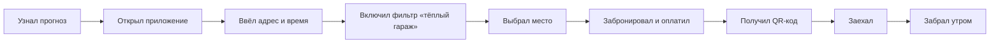

### Кандидат 1: ПаркТепло — аренда парковок и тёплых гаражей

| Требование | Проверка | Итог |
|---|---|---|
| 2–3 ограниченных контекста | Места и объекты · Бронирование и доступ · Платежи и выплаты · Пользователи и отзывы · Уведомления | ✅ пять |
| Внешняя интеграция | Карты и геолокация, платёжный шлюз, СКУД/умные замки, QR-коды, прогноз погоды, email/SMS/push | ✅ |
| Пользовательский интерфейс | Карта, поиск по адресу и времени, фильтры «тёплый гараж», «розетка», карточка места, бронирование, личный кабинет, панель владельца | ✅ |
| Нетривиальные данные | Места, типы отопления, температура, розетки, интервалы, брони, автомобили, платежи, залоги, логи доступа, отзывы | ✅ связи и история |

**Вывод:** домен проходит.

## Постановка проблемы

**Что**: В мороз машины на улице не заводятся, аккумулятор садится, прогрев занимает время, а свободные тёплые гаражи и подземные паркинги простаивают. Найти тёплое место на ночь заранее почти невозможно — всё решается через знакомых и объявления.

**Для кого**: Водители, которые оставляют машину во дворе и мучаются с запуском зимой, и владельцы частных гаражей, машиномест и подземных паркингов, которые хотят сдавать их на часы или ночь.

**Зачем**: Водитель гарантированно получает тёплое место и утром не рискует опоздать; владелец зарабатывает на простое.

**Как измерим успех**: Доля броней тёплых гаражей в зимний период, загрузка тёплых мест в морозные ночи, доля повторных броней.

### Персона: Водитель из спального района

**Роль и контекст**: Каждый день ездит на работу, машина стоит во дворе. Зимой тратит 15–20 минут на прогрев и рискует не завестись.

**Цель**: Оставить машину на ночь в тёплом месте и утром уехать без сюрпризов.

**Как решает задачу сейчас**: Спрашивает знакомых, ищет объявления, иногда ставит на платную парковку без отопления.

**Боли**:
- Не знает, есть ли свободный тёплый гараж рядом
- Боится, что место займут
- Непонятно, можно ли продлить, если машина не завелась

**Что важно**: Видеть температуру и розетку; бронировать за пару минут; получать доступ без звонков.

### Персона: Владелец гаража или машиноместа

**Роль и контекст**: Имеет гараж или место в подземном паркинге, которое простаивает. Зимой хочет сдавать его на ночь или на неделю.

**Цель**: Получать доход и не заниматься поиском клиентов вручную.

**Как решает задачу сейчас**: Пишет в чаты домов, клеит объявления, договаривается по телефону.

**Боли**:
- Не хочет пускать незнакомых
- Боится, что не заплатят
- Нужно вручную следить за занятостью

**Что важно**: Видеть брони и оплату; указывать температуру и условия; иметь историю доступа.

## Путь пользователя: бронирование тёплого гаража на ночь

Персона: Водитель из спального района
Сценарий: снять тёплый гараж на ночь, чтобы утром машина завелась

1. **Узнал прогноз** — вечером понял, что ночью будет −28
2. **Открыл приложение** — с телефона
3. **Ввёл адрес и время** — сегодня 22:00 — завтра 08:00
4. **Включил фильтр** — «тёплый гараж» и «розетка»
5. **Выбрал место** — гараж с температурой +12 и видеонаблюдением
6. **Забронировал и оплатил** — один шаг, без звонков
7. **Получил QR-код** — инструкция по доступу и код замка
8. **Заехал** — закрыл машину, ушёл
9. **Забрал утром** — при необходимости продлил бронь

## Минимально жизнеспособный продукт

Входит:
- Поиск тёплых гаражей на карте по адресу и времени
- Фильтр «тёплый гараж», «розетка», «доступ 24/7»
- Карточка места с температурой и условиями
- Бронирование свободного интервала
- Оплата брони
- QR-код или код доступа
- Список броней для водителя
- Список броней и занятости для владельца
- Отмена брони
- Базовые уведомления

Критерий: водитель может пройти сценарий «нашёл тёплое место — забронировал — оплатил — заехал — выехал — продлил/отменил» без звонка владельцу.

## Вне области охвата этого семестра

| Не делаем | Почему |
|---|---|
| Автозапуск двигателя | Отдельная техническая и юридическая область |
| Эвакуацию и техпомощь | Не входит в проверяемую гипотезу |
| Мойку и ремонт | Другая предметная область |
| Страхование машины | Требует договора со страховщиком |
| Динамические цены | Отдельная аналитика, для MVP не нужна |
| Собственные датчики температуры | В MVP владелец указывает вручную; v1.1 — интеграция |
| Мобильное приложение | Веб-версия закрывает сценарий |
| Несколько городов | Усложняет карты, тарифы и поддержку |
| Интеграцию с ГИБДД | Требует официальных соглашений |